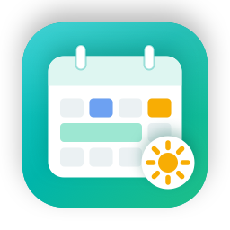

<p align="center"></p>

# 🗓️ LifeOS

学习之外的生活，放在一个“高级日历”上。CourseOS 的姊妹 App：同一套 SwiftUI 架构和界面，
定位不同——不是待办清单，没有打卡、完成率和反思。

- **三种事项**：约定（有起止时间）、期限（过了会出事，提前几天出现在“快到了”）、时间窗（这段时间内找空做）
- **课程图层（只读）**：从 CourseOS 学期目录读上课时间（按你的 section）、截止、考试、长期项目节点
- **负荷**：上课 + 约定 + 课业（课程截止的预估工作量摊到截止前几天），每天标“轻松 / 一般 / 很满”
- **轻提示**：时间重叠、考试当天/前一晚有安排、很满的一天——只提醒，不拦
- **找空档**：时间窗按负荷推荐哪天哪段时间去办，一键排进去
- **收件箱**：随手记一句，交给 agent（life-manager skill）整理，它会先问你再放进日历
- **准备信息**：选中事项，让 agent 查地址、路程、要带的材料，写进事项正文
- 周视图拖动改时间（15 分钟对齐、可跨天），所有改动可撤销；过去的事自然淡出

## 构建

```bash
./Scripts/bootstrap.sh
xcodebuild -project LifeOS.xcodeproj -scheme LifeOS -configuration Debug -derivedDataPath build.noindex build
open build.noindex/Build/Products/Debug/LifeOS.app
```

## 准备 vault

数据都在一个 vault 文件夹里（默认 `~/Documents/LifeOS`，首次打开可选其他位置），每件事一个 Markdown 文件，Obsidian 可读。

1. 把 `templates/vault/` 复制成你的 vault，按需改 `lifeos.json`（CourseOS 学期目录、上课起止日、section）。
2. 给 agent 装 skill：`npx skills add Geek96/life-manager`（或把 `skills/life-manager` 链接进 `~/.claude/skills/`）。
3. 打开 LifeOS，设置里选 vault 和 CourseOS 学期目录。

## 和 CourseOS 的关系

[CourseOS](https://github.com/Geek96/courseos) 管课程，LifeOS 管生活。LifeOS 只读 CourseOS 的学期目录，从不写回。
